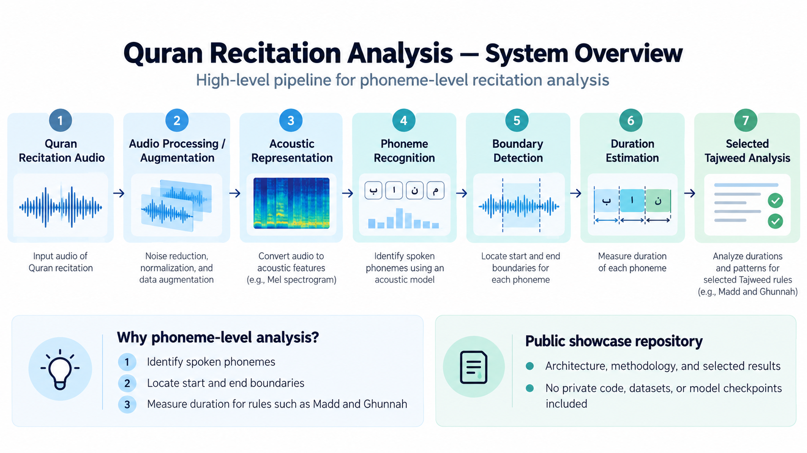
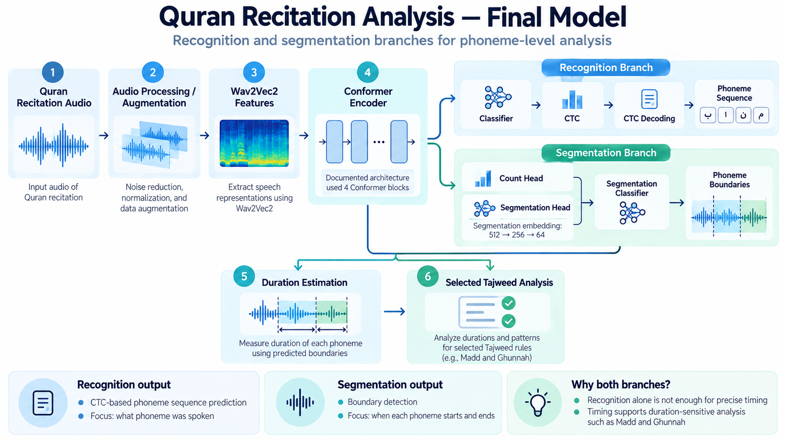
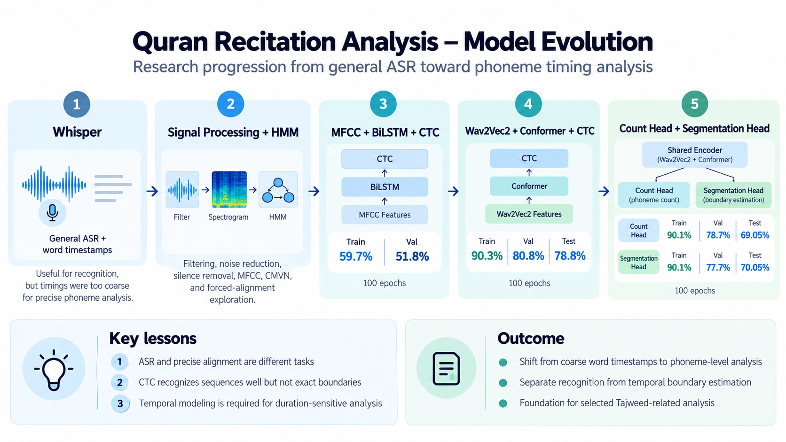

# Quran Recitation Analysis

An **Audio AI system for Quran recitation analysis** using phoneme recognition, boundary detection, duration estimation, CTC, Wav2Vec2, and Conformer.

The project investigates how deep learning and speech-processing techniques can analyze Quran recitation at the **phoneme level**, going beyond conventional speech-to-text toward temporal analysis of pronunciation and selected Tajweed-related features.

<p align="center">
  <strong>
    Audio AI • Speech Processing • Phoneme Recognition • Wav2Vec2 • Conformer • CTC • Tajweed Analysis
  </strong>
</p>

> **Public showcase repository**
>
> This repository presents the research methodology, architecture, model evolution, selected experimental results, limitations, and illustrative examples of a team graduation project.
>
> Full training and inference code, private preprocessing and experiment code, model checkpoints, datasets, and restricted audio are intentionally excluded.

---

## 🎯 Project Overview

Correct Quran recitation involves more than recognizing which words were spoken.

Some pronunciation and Tajweed-related characteristics depend on:

- the phoneme that was pronounced
- the order of phonemes
- the temporal location of each phoneme
- its beginning and ending boundaries
- its duration
- differences between expected and observed pronunciation

The project therefore investigates **phoneme-level Quran recitation analysis** with three main technical objectives:

1. **Phoneme Recognition** — identify the spoken phoneme sequence.
2. **Phoneme Boundary Detection** — estimate where individual phonemes begin and end.
3. **Phoneme Duration Estimation** — calculate temporal duration for further analysis.

These outputs provide a foundation for analyzing selected pronunciation and Tajweed-related phenomena, especially duration-sensitive cases such as **Madd** and **Ghunnah**.

The intended role is **assistive education**. The system does not replace a qualified Quran teacher.

---

## 🖼️ System Overview

<p align="center">
  
</p>

At a high level, the project follows this pipeline:

```text
Quran Recitation Audio
        │
        ▼
Audio Processing / Augmentation
        │
        ▼
Acoustic Representation
        │
        ▼
Phoneme Recognition
        │
        ▼
Boundary Detection
        │
        ▼
Duration Estimation
        │
        ▼
Selected Tajweed Analysis
```

The system aims to combine **what was pronounced** with **when it was pronounced**.

---

## 🧠 Why Phoneme-Level Analysis?

Ordinary automatic speech recognition answers questions such as:

> **What words were spoken?**

For detailed recitation analysis, that is not enough.

The project also needs to approach questions such as:

> **Which phonemes were spoken?**

> **Where did each phoneme begin and end?**

> **How long did each phoneme last?**

Word-level timestamps do not necessarily provide the temporal precision needed for phoneme-duration analysis.

This distinction became important throughout the project and influenced the progression from general speech recognition toward dedicated phoneme recognition and segmentation.

---

## 🏗️ Final Model Architecture

<p align="center">
  
</p>

The final research direction separates **phoneme recognition** from **temporal segmentation**.

```text
                    Quran Recitation Audio
                             │
                             ▼
                Audio Processing / Augmentation
                             │
                             ▼
                     Wav2Vec2 Features
                             │
                             ▼
                      Conformer Encoder
                             │
                 ┌───────────┴───────────┐
                 │                       │
                 ▼                       ▼
          Recognition Branch      Segmentation Branch
                 │                       │
                 ▼                       ▼
            Classifier              Count Head
                 │                 Segmentation Head
                 ▼                       │
                CTC                      ▼
                 │              Segmentation Classifier
                 ▼                       │
           CTC Decoding                  ▼
                 │                Phoneme Boundaries
                 ▼                       │
          Phoneme Sequence               │
                 └───────────┬───────────┘
                             ▼
                    Duration Estimation
                             │
                             ▼
               Selected Tajweed Analysis
```

A documented architecture used **4 consecutive Conformer blocks**.

### Recognition Branch

The recognition branch focuses on:

> **What phoneme was spoken?**

Its conceptual flow is:

```text
Wav2Vec2 Features
        │
        ▼
Conformer Encoder
        │
        ▼
Classifier
        │
        ▼
CTC
        │
        ▼
CTC Decoding
        │
        ▼
Phoneme Sequence
```

---

### Segmentation Branch

The segmentation branch focuses on:

> **When does each phoneme begin and end?**

The Segmentation Head learns a task-specific representation by reducing the encoded features approximately as:

```text
512 → 256 → 64
```

Conceptually:

```text
Conformer Features
        │
        ▼
Segmentation Head
        │
        ▼
Segmentation Classifier
        │
        ▼
Boundary Detection
        │
        ▼
Start / End Frames
        │
        ▼
Phoneme Duration
```

Separating these tasks allows recognition and temporal analysis to be optimized for different objectives.

---

## 🔬 Model Evolution

<p align="center">
  
</p>

The final architecture was reached through several experimental stages.

| Stage | Approach | Purpose / Observation |
|---|---|---|
| 1 | Whisper | Explored general ASR and word timestamps |
| 2 | Signal Processing + HMM | Explored preprocessing and forced alignment |
| 3 | MFCC + BiLSTM + CTC | Learned phoneme sequence recognition |
| 4 | Wav2Vec2 + Conformer + CTC | Improved acoustic/contextual modeling |
| 5 | Count Head + Segmentation Head | Separated phoneme recognition from temporal boundary estimation |

---

## 1️⃣ Whisper Experiment

The project initially explored **Whisper** for speech recognition and word-level timestamps.

The intended workflow was approximately:

```text
Recitation
   │
   ▼
Whisper
   │
   ▼
Recognized Words
   │
   ▼
Word Timestamps
   │
   ▼
Extract Audio Segments
   │
   ▼
Pronunciation Analysis
```

Whisper was useful for general speech recognition, but experiments showed that its temporal estimates were insufficient for the precision required by phoneme-level analysis.

Observed issues included:

- approximate timestamps
- overlap between neighboring word segments
- insufficient precision for short phonemes
- difficulty obtaining reliable phoneme duration

This demonstrated an important distinction:

> **Speech recognition and precise temporal alignment are different tasks.**

---

## 2️⃣ Traditional Signal Processing & HMM Exploration

The project then explored a more controlled audio-analysis pipeline.

Techniques investigated included:

- High-Pass Filtering
- Band-Pass Filtering
- Noise-profile estimation
- Noise reduction
- Energy-based silence removal
- MFCC
- Delta MFCC
- Delta-Delta MFCC
- CMVN
- Hidden Markov Models
- Forced Alignment

The HMM direction aimed to align known Quran text with the audio signal so that temporal locations could be estimated more directly.

The emphasis shifted from:

```text
What was spoken?
```

toward:

```text
When was each known unit spoken?
```

---

## 3️⃣ MFCC + BiLSTM + CTC

The project later moved toward deep learning for phoneme recognition.

The pipeline included:

```text
Audio
   │
   ▼
Audio Augmentation
   │
   ▼
MFCC / CMVN
   │
   ▼
BiLSTM
   │
   ▼
Neural Classifier
   │
   ▼
CTC
   │
   ▼
CTC Decoding
   │
   ▼
Phoneme Sequence
```

A documented experiment trained for **100 epochs** and reported:

| Metric | Accuracy |
|---|---:|
| Training | 59.7% |
| Validation | 51.8% |

These values are specific to that experiment and are not universal measures of Quran-recitation quality.

---

## 4️⃣ Wav2Vec2 + Conformer + CTC

The BiLSTM-based sequence model was later replaced with a **Conformer encoder**.

The Conformer architecture combines:

- self-attention for long-range context
- convolution for local acoustic patterns

This makes it well suited to speech signals containing both local phonetic details and longer temporal dependencies.

The documented architecture used:

```text
Conformer Block 1
      ↓
Conformer Block 2
      ↓
Conformer Block 3
      ↓
Conformer Block 4
```

The recognition pipeline became:

```text
Audio
   │
   ▼
Wav2Vec2
   │
   ▼
Conformer
   │
   ▼
Classifier
   │
   ▼
CTC
   │
   ▼
CTC Decoding
   │
   ▼
Phoneme Sequence
```

A documented experiment trained for **100 epochs** and reported:

| Split | Accuracy |
|---|---:|
| Training | 90.3% |
| Validation | 80.8% |
| Test | 78.8% |

---

## 5️⃣ Count Head & Segmentation Head

CTC was effective for predicting phoneme sequences, but sequence recognition alone did not reliably determine exact phoneme boundaries.

This motivated dedicated temporal-analysis components.

### Count Head

The Count Head was designed to estimate the approximate number of phonemes in an audio segment.

It uses information derived from encoded audio features such as:

- mean
- standard deviation
- sequence length

Conceptually:

```text
Encoded Audio Features
        │
        ├── Mean
        ├── Standard Deviation
        └── Sequence Length
                │
                ▼
            Count Head
                │
                ▼
      Estimated Phoneme Count
```

---

### Segmentation Head

The Segmentation Head focuses specifically on temporal boundary estimation.

The encoded features are transformed approximately as:

```text
512 → 256 → 64
```

to create a representation more specific to segmentation.

Conceptually:

```text
Encoded Features
       │
       ▼
Segmentation Embedding
       │
       ▼
Segmentation Classifier
       │
       ▼
Boundary Predictions
```

An illustrative segmentation might look like:

```text
Frames 1–20   → phoneme A
Frames 21–45  → phoneme B
Frames 46–65  → phoneme C
Frames 66–80  → phoneme D
```

From these predicted boundaries:

```text
Start Frame + End Frame
           │
           ▼
     Phoneme Duration
```

---

## 🔤 Phoneme Representation

A major part of the project involved representing Quranic pronunciation in a way suitable for acoustic modeling.

The project explored phonetic handling for areas including:

- definite article behavior with sun and moon letters
- taa marbuta
- stopping behavior
- hamzat al-wasl
- Ghunnah
- noon sakinah and tanween rules
- meem sakinah rules
- Idgham-related cases
- emphatic raa
- qalqalah

The objective was to create a pronunciation-aware representation rather than treating written Arabic characters as direct acoustic labels.

> These are explored categories, not a claim that every Tajweed rule is fully modeled end-to-end.

The complete private conversion implementation and full label inventory are not distributed in this repository.

---

## 🔊 Audio Processing

Audio preprocessing was explored extensively during the project.

### Frequency Filtering

Experiments included:

- High-Pass Filtering
- Band-Pass Filtering

One preprocessing experiment investigated an approximate frequency range of:

```text
300 Hz – 4500 Hz
```

to emphasize useful speech information while reducing unwanted low- and high-frequency components.

---

### Noise Reduction

A noise profile was estimated from an initial quiet portion of recordings and used for background-noise reduction.

The experiments also showed that overly aggressive noise reduction could affect useful acoustic characteristics, so preserving the speech signal remained important.

---

### Silence Removal

Energy-based silence detection was explored for removing low-energy regions from the beginning and end of recordings.

---

### Acoustic Features

Earlier experiments used:

- MFCC
- Delta MFCC
- Delta-Delta MFCC
- CMVN

Later experiments moved toward learned Wav2Vec2-style representations.

---

## 📚 Dataset

The project report documents approximately **100 hours of Quran recitation audio**.

| Subset | Approximate Duration |
|---|---:|
| Training | 80 hours |
| Validation | 10 hours |
| Test | 10 hours |

The experimental design included different reciters across subsets.

The test configuration also included different verses and different voices, helping investigate generalization beyond the training speakers.

### Dataset Availability

The dataset is **not distributed in this repository**.

Reasons include:

- ownership considerations
- licensing requirements
- audio redistribution rights
- repository size
- usage restrictions where applicable

No training audio or corpus manifests are included here.

---

## 📈 Experimental Results

The following values are selected reported results from specific project experiments.

| Experiment | Train | Validation | Test | Epochs |
|---|---:|---:|---:|---:|
| MFCC + BiLSTM + CTC | 59.7% | 51.8% | Not reported | 100 |
| Wav2Vec2 + Conformer + CTC | 90.3% | 80.8% | 78.8% | 100 |
| Segmentation-related experiment A | 90.1% | 78.7% | 69.05% | 100 |
| Segmentation-related experiment B | 90.1% | 77.7% | 70.05% | 100 |

> **Metric interpretation**
>
> These are experiment-specific reported accuracy values.
>
> They are **not**:
>
> - universal Tajweed accuracy
> - Phoneme Error Rate (PER)
> - Character Error Rate (CER)
> - production guarantees
>
> Exact scoring definitions and complete experiment protocols are not distributed through this public showcase, so these experiments should not be treated as a controlled public benchmark.

Additional discussion is available in:

```text
docs/results/
```

---

## 🧩 Recognition vs. Segmentation

One of the most important lessons from the project was that **recognition and alignment are different problems**.

### Recognition

CTC attempts to determine:

```text
What sequence of phonemes was spoken?
```

### Segmentation

The segmentation branch attempts to determine:

```text
When does each phoneme begin and end?
```

A correct phoneme sequence does not guarantee a correct temporal distribution across audio frames.

For duration-sensitive analysis, both outputs are needed.

---

## ⚠️ Key Challenges

### ASR vs. Alignment

Correctly recognizing linguistic content does not guarantee precise acoustic boundaries.

---

### CTC vs. Exact Timing

CTC is useful for sequence recognition without requiring exact frame-level labels.

However, the resulting sequence alone does not reliably provide real phoneme start/end boundaries.

---

### Speaker Generalization

Different speakers vary in:

- voice characteristics
- pronunciation
- speed
- pitch
- recording environment
- recitation style

Generalizing across unseen reciters therefore remains challenging.

---

### Overfitting

Some experiments showed a noticeable gap between training and unseen-speaker evaluation.

This motivates further work on:

- speaker diversity
- augmentation
- regularization
- larger evaluation datasets

---

### Temporal Modeling

Errors in boundary prediction directly affect duration estimation.

This is especially important for analyses involving phenomena such as Madd and Ghunnah.

---

## 🎧 Illustrative Output Format

The public repository contains generic examples showing how future model results could be represented.

For example:

```json
{
  "source": "illustrative_example",
  "phonemes": [
    {
      "label": "phoneme_1",
      "start_seconds": 0.0,
      "end_seconds": 0.2,
      "duration_seconds": 0.2
    },
    {
      "label": "phoneme_2",
      "start_seconds": 0.2,
      "end_seconds": 0.48,
      "duration_seconds": 0.28
    }
  ],
  "tajweed_analysis": {
    "status": "illustrative_only"
  }
}
```

These examples demonstrate data structure only.

They are **not real model predictions**.

See:

```text
examples/
```

---

## 📂 Repository Structure

```text
quran-recitation-analysis/
├── README.md
├── LICENSE
├── CITATION.cff
├── .gitignore
│
├── docs/
│   ├── architecture/
│   │   ├── README.md
│   │   ├── system-overview.png
│   │   ├── model-evolution.png
│   │   └── final-model.png
│   │
│   ├── results/
│   │   ├── README.md
│   │   ├── experiment-summary.md
│   │   ├── phoneme-recognition.md
│   │   └── segmentation-example.md
│   │
│   ├── methodology.md
│   └── limitations.md
│
├── examples/
│   ├── README.md
│   ├── sample-phoneme-sequence.json
│   └── sample-analysis.json
│
├── assets/
│   └── audio/
│       └── README.md
│
├── references/
│   └── README.md
│
└── PROJECT_NOTES.md
```

---

## 🔒 Repository Scope

This repository is intentionally a **technical showcase**, not the complete original project repository.

### Publicly Included

- project methodology
- system architecture
- model evolution
- selected experimental results
- architecture diagrams
- generic illustrative examples
- technical limitations
- academic attribution

### Intentionally Not Included

- full training source code
- full inference source code
- private preprocessing code
- private experiment code
- trained model checkpoints
- training datasets
- restricted Quran recitation recordings
- private configuration
- production assets

The public/private separation is intentional.

---

## 🛠️ Technologies

### Deep Learning

- Python
- PyTorch
- Wav2Vec2
- Conformer
- BiLSTM
- CTC Loss
- CTC Decoding

### Speech & Audio Processing

- Phoneme Recognition
- Phoneme Boundary Detection
- Phoneme Duration Estimation
- Speech Recognition
- Audio Augmentation
- MFCC
- Delta MFCC
- Delta-Delta MFCC
- CMVN
- Noise Reduction
- Energy-Based Silence Detection

### Experimental Methods

- Whisper
- Hidden Markov Models
- Forced Alignment
- Neural Sequence Modeling
- Count Head
- Segmentation Head

---

## 🚧 Limitations

This project should be understood as a **research and graduation-project prototype**.

Current limitations include:

- generalization to unseen speakers
- limited dataset diversity
- sensitivity to recording conditions
- phoneme-boundary estimation difficulty
- limited public evaluation data
- no public reproducible benchmark
- not every Tajweed rule is modeled end-to-end
- experimental rather than authoritative educational feedback

No claim of full automatic Tajweed correction is made.

The system should **not** be considered a replacement for a qualified Quran teacher.

See:

```text
docs/limitations.md
```

for additional details.

---

## 🔮 Future Work

Potential research directions include:

- larger and more diverse speaker datasets
- stronger speaker-independent evaluation
- improved phoneme-boundary supervision
- better duration modeling
- improved forced alignment
- stronger augmentation
- speaker normalization
- Phoneme Error Rate (PER) evaluation
- boundary-error metrics in milliseconds
- duration-error metrics
- confidence estimation
- rule-specific Tajweed analysis
- interactive visual phoneme alignment
- real-time inference
- mobile integration
- personalized learner feedback

These are research directions and are not features currently delivered by this repository.

---

## 🎓 Academic Context

This work was developed as a **fifth-year graduation project** at:

**Aleppo University**  
Faculty of Informatics Engineering  
Department of Artificial Intelligence and Natural Languages

### Project Team

- Mahmoud Bannan
- Mohammed Deeb Jalab
- Mohanad Al-Abd Allah
- Amjad Haj Hammada
- Mahmoud Abd Al-Rhim
- Hayder Qasem

### Supervisor

**Dr. Mohammed Fadel Sukkar**

The complete team is also credited in [`CITATION.cff`](CITATION.cff).

This public showcase repository is maintained by **Mahmoud Bannan**.

---

## ⚖️ Responsible Use

Quran recitation assessment is a specialized domain involving linguistic, phonetic, pedagogical, and religious expertise.

AI predictions can be inaccurate.

This project is intended to explore technology that can **assist** recitation learning and analysis.

It should not be used as the sole authority for Quran recitation correction.

For authoritative instruction and correction, users should consult qualified Quran teachers and specialists.

---

## 👨‍💻 Maintainer

**Mahmoud Bannan**

Flutter Developer & Audio AI Engineer

- GitHub: [@Mahmoudmnb](https://github.com/Mahmoudmnb)
- Portfolio: [mahmoudbannan.com](https://mahmoudbannan.com)
- LinkedIn: [Mahmoud Bannan](https://www.linkedin.com/in/mahmoudbannan)

---

## 📄 License

See [`LICENSE`](LICENSE) for the repository's documentation-focused license notice.

The repository license does **not** grant rights to:

- private source code
- private experiment code
- model checkpoints
- datasets
- third-party audio
- Quran recitation recordings
- third-party copyrighted material
- materials not included in this repository

Any reuse must also respect the rights of the original contributors and relevant third-party rights holders.